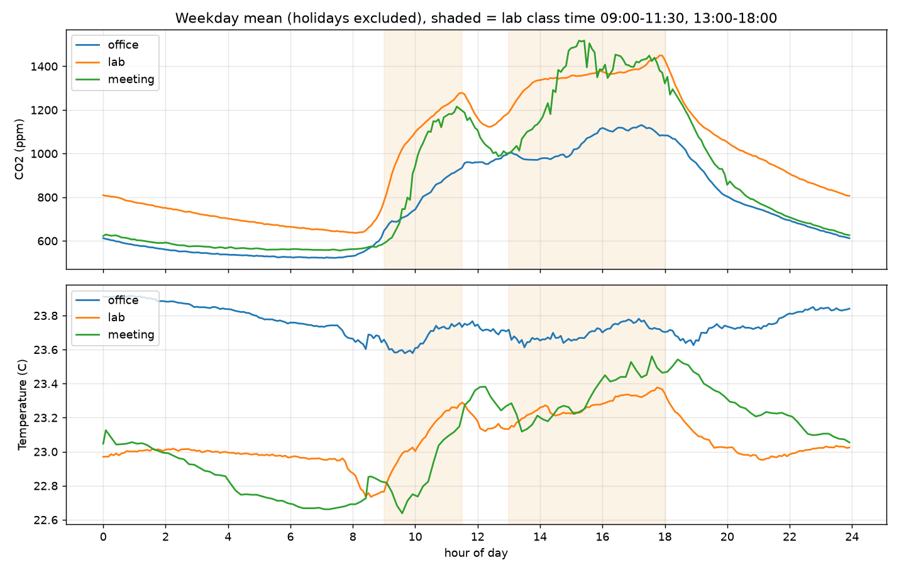

# 시계열 데이터 추론 실습 최종 결과 보고서 (2팀)

Oct 22, 2026 · @김채림

## 1. 데이터 수집 체계

**확인 기준:** ① 상시 수집, 설정만 바꿔 새 형식 대응 ② 브로커·네트워크·보드 재부팅 뒤 자동 복구(1분 안) ③ 24시간 커버율 95% 이상, 빠진 구간의 원인 설명 → **충족** (커버율 99.4~99.9%, 낮은 곳은 센서 주기로 설명)

**MQTT 수집기를 젯슨에 상시 서비스로 돌려 60개 공간·항목을 모았고, 재부팅·네트워크 끊김 뒤에도 사람 손 없이 복구해 데이터를 잃지 않았다.** 저장은 젯슨 SQLite(원본·전송 대기열) → PostgreSQL이고, 학교 InfluxDB는 읽기 전용이다.

| 요구사항                 | 결과                                                                                          |
|--------------------------|-----------------------------------------------------------------------------------------------|
| 상시 수집·현황 보기      | 18시간 무인 가동(이후 계속), 전송 대기 0건, status.py로 건수·마지막 수신·커버율               |
| 설정만 바꿔 새 형식 대응 | config.yaml 규칙 12줄 추가 → 미분류 23 → 5건, 코드 변경 없음                                  |
| 자동 복구                | 재부팅 1분 내 재시작, 와이파이 60초 차단 → 15초 만에 재접속·무손실                            |
| (심화) 중복·보관         | 재전송 468건 제거(devEui+fCnt+날짜) / 1년 15.4GB → 원본 30일·10분 집계 1년·1시간 영구로 2.9GB |

| 공간                       | 항목 수 | 전송 주기 | 커버율     | 판정                      |
|----------------------------|---------|-----------|------------|---------------------------|
| 실습실                     | 13      | 60~330초  | 99.4~99.9% | 정상                      |
| 사무실·사무실 밖           | 6       | 60초      | 99.6~99.9% | 정상                      |
| 대표실·컨트롤러·집중회의실 | 22      | 60초      | 99.7~99.8% | 정상                      |
| 회의실                     | 3       | 600초     | 9.9%       | 센서가 10분마다 보내 정상 |
| 개발실 실내기·실외기       | 16      | 63~85초   | 68.7~68.8% | 기기가 약 85초마다 전송   |

*측정 조건 — 실데이터, 2026-10-20 15:46 ~ 10-21 10:02(약 18시간), 학교 브로커 전체 토픽 QoS 1. 커버율 = 지나간 1분 칸 중 데이터가 있는 칸의 비율. 재부팅 시험 10-20 17:28, 네트워크 차단 17:34~17:35. 용량은 10-21 11:03 기준 19.3시간 75,323행에서 추정. 젯슨 Orin Nano, 25W.*

**해석:** 비어 보이는 데이터의 원인은 수집기가 아니라 센서 주기였다(회의실 10분, 개발실 85초). 그래서 커버율은 센서별 기대 주기로 판정해야 한다. LoRa 게이트웨이 시계가 약 5분 빨라 센서 시각(time) 대신 네트워크 서버 수신 시각(nsTime)을 쓴다. 브로커 재시작은 학교 서버라 직접 시험하지 못했고, 같은 재접속 경로를 네트워크 차단으로 확인했다.

## 2. 데이터 이해와 기준선

**확인 기준:** ① 정규화 값은 학습 기간만으로 계산 ② 기준선과 모델을 같은 시점·같은 조건에서 평가 ③ 세 기준선 중 가장 강한 것과 그 이유 → **충족** (현재값 유지 최강, 모델과 같은 창에서 41.0ppm)

**세 기준선 중 "현재값 유지"가 모든 공간·지평에서 가장 강했다(60분 뒤 CO2 41.0ppm).** 7주 실데이터에서 수업·점심·퇴실이 뚜렷하게 보였고, CO2는 일정 변화 뒤 5~8분 만에 반응했다. 단, 시간표는 수업의 약 12%에서 실제와 달랐다.

*그림 2-1. 평일(공휴일 제외) 5분 단위 평균. 실습실(lab) CO2는 9시 급등 → 11:30 점심 하락 → 13시 재상승 → 18시 이후 감소. 평균만으로도 10~19시에 1,000ppm을 넘는다. 온도 변화는 하루 0.5℃ 안팎. 실데이터 2026-09-01~10-22.*

| 기준선          | 5분     | 15분     | 30분     | 60분 CO2 | 60분 온도  | 60분 CO2 실습실 / 회의실 |
|-----------------|---------|----------|----------|----------|------------|--------------------------|
| **현재값 유지** | **8.6** | **15.5** | **24.1** | **41.0** | **0.106℃** | 41.9 / 37.5              |
| 최근 1시간 평균 | 23.1    | 28.9     | 37.4     | 53.5     | 0.146℃     | 54.6 / 47.1              |
| 어제 같은 시각  | 112.0   | 112.2    | 112.5    | 113.5    | 0.538℃     | 77.0 / 146.7             |

*측정 조건 — 실데이터(학교 InfluxDB) 2026-09-01~10-22 08:28(51.4일), 461,181행(1분 평균), 실습실·사무실·회의실. 시험 10-14~21, 평가점 6,477개(실습실 수업 시간 540개, 현재값 유지 81.7ppm). CO2 MAE(ppm). 모델(3장)과 같은 창·같은 정제·같은 시점. 정규화는 학습 기간(09-01~10-06)만으로 계산(CO2 평균 794.7, 표준편차 491.1). 젯슨 25W.*

| 일정 변화 (실습실, 각 33회) | ±30ppm까지 걸린 시간 (중앙값, 25~75%) | 60분 변화 | 반응 없음 |
|-----------------------------|---------------------------------------|-----------|-----------|
| 09:00 수업 시작             | 5.5분 (4~6)                           | +293ppm   | 3회       |
| 13:00 수업 시작             | 6분 (4~16)                            | +140ppm   | 4회       |
| 11:30 점심                  | 8분 (3.5~12.5)                        | −177ppm   | 5회       |
| 18:00 퇴실                  | 6분 (4~11)                            | −243ppm   | 2회       |

**정제·분할 규칙:** ① 불가능한 값(CO2 350~5,000, 온도 5~40℃, 습도 5~100% 밖) 제거 — 51일간 0건. ② 한 칸만 CO2 300ppm·온도 3℃ 뛰었다 돌아오는 튄 값 제거 — 회의실 CO2 34개(0.46%)만. ③ 결측은 CO2 10분·온습도 30분까지 보간, 그 이상은 비움 — 수신률(센서 주기 기준) 98.6~99.4%, 1시간 넘는 결측 0번. ④ 1분·10분 센서를 5분 평균으로 맞춤 — 잡음 9.4 → 5.8ppm, 반응(5~8분) 보존. ⑤ 시간순 분할, 입력부터 정답까지 한 구간 안 — 이웃 칸 상관 0.997이라 무작위로 섞으면 오차가 8.3ppm으로 부풀려진다(실제 52.1).

*측정 조건 — 정제 결과는 위와 같은 51일 실데이터. 잡음(9.4 → 5.8ppm)과 무작위 분할 실험(8.3 vs 52.1ppm)은 초기 실데이터 2026-10-20 15:46~10-21 13:01(21.2시간, 실습실 CO2, 5분 평균)에서 측정. 젯슨 25W.*

- **현재값 유지가 강한 이유:** 5분 뒤 값과 상관이 0.997이다. '어제 같은 시각'은 지금 값을 쓰지 않아 가장 약하고, 일과가 고정된 실습실(77)에서만 덜 나쁘다.

- **일정과 어긋난 날:** 수업 66회 중 8회는 CO2가 50ppm도 오르지 않았고(9/28~30 집중), 수업 없는 주말 6일은 150ppm 넘게 올랐다. 이 12%가 3장에서 실데이터 이득이 작은 이유다.

## 3. 60분 예측

**확인 기준:** 같은 시점에서 기준선(현재값 유지)보다 60분 예측이 정확할 것 → **충족** (CO2 합성 16.0 vs 39.2ppm, 실데이터 34.5 vs 40.8ppm)

**시간표를 미래 입력으로 넣은 GRU가 기준선을 이겼다. 합성 데이터에서는 오차를 59% 줄였지만 실데이터에서는 15%였고,** 그 이득은 시간표가 있는 실습실(48%)에 몰려 있다. 실데이터는 젯슨을 학교 유선망에 연결해 학교 InfluxDB의 2학기 데이터(09-01~10-22)를 받아 같은 코드로 다시 학습했다.

| 모델 (60분 뒤)    | 합성 CO2 | 합성 온도 | 실데이터 CO2 | 실데이터 온도 |
|-------------------|----------|-----------|--------------|---------------|
| **GRU**           | **16.0** | **0.047** | 34.5         | 0.115         |
| LSTM              | 16.7     | —         | 36.4         | 0.105         |
| TCN               | 16.9     | —         | **33.4**     | 0.120         |
| GRU (시간표 제외) | 23.8     | —         | 38.0         | 0.106         |
| 현재값 유지       | 39.2     | 0.188     | 40.8         | **0.105**     |
| 최근 1시간 평균   | 48.3     | —         | 53.1         | 0.146         |
| 어제 같은 시각    | 55.3     | —         | 109.5        | 0.537         |

*측정 조건 — CO2 ppm, 온도 ℃(MAE). 합성: 2026-09-21~10-18(4공간), 학습 09-21~10-04 / 검증 10-05~11 / 시험 10-12~18. 실데이터: 2026-09-01~10-22(3공간, 461,181행), 학습 09-01~10-06 / 검증 10-07~13 / 시험 10-14~21, 공휴일 제외. 입력 과거 2시간(5분×24칸), 세 기준선이 모두 있는 같은 시점만 평가. 젯슨 25W CPU 학습(합성 703초, 실데이터 334초). —: 미기록.*

| 심화: 실데이터 60분 CO2 | 과거 60분 | 120분 | 240분 | 처음 보는 공간(회의실)            |
|-------------------------|-----------|-------|-------|-----------------------------------|
| GRU                     | **34.1**  | 34.9  | 36.5  | 회의실 빼고 학습 37.1 / 포함 37.3 |
| LSTM                    | 35.5      | 37.1  | 35.7  | —                                 |
| TCN                     | **33.2**  | 33.9  | 34.0  | —                                 |
| 현재값 유지             | —         | —     | —     | 37.5                              |

*측정 조건 — 실데이터, 위와 같은 분할. 과거 길이 비교는 세 길이 모두에 있는 시점만, 시드 1개(차이 1~3ppm은 확정적이지 않음). 처음 보는 공간은 회의실 1,939점, 과거 120분, 두 모델 모두 공간 구분 입력 제거. 젯슨 25W.*

- **원인:** CO2 변화는 사람의 출입이고, 출입을 미리 알려 주는 것은 시간표뿐이다. 실습실 수업 시간에서 시간표를 빼면 오차가 48.7 → 76.9ppm. 합성은 사람이 시간표대로만 움직여 이득을 4배 가까이 부풀렸다.

- **심화:** 과거는 1시간이면 충분하고(길면 배울 것만 늘어남), 처음 보는 공간에서도 나빠지지 않지만 이득도 없다. 이득은 공간이 아니라 일정에서 나온다.

- **행동:** 회의실 예약·근무 일정을 입력으로 확보하고, 그 전까지 일정 없는 공간과 60분 온도는 현재값 유지를 기본으로 둔다.

## 4. 이상 탐지

**확인 기준:** ① 모델과 규칙을 합쳐 이벤트 탐지율 80% 이상 ② 헛경보 하루 1회 이하 ③ 모델·규칙이 각각 못 잡는 고장과 이유 → **충족** (87%, 0.43회/일)

**규칙과 모델을 합치자 고장 15건 중 13건(87%)을 잡았고 헛경보는 하루 0.43회였다.** 어떤 방법도 혼자서는 60%를 넘지 못했다. 고장 종류마다 잡는 방법이 달랐기 때문이다. 경보 13건 중 12건은 원인 센서도 맞혔다.

| 방법                      | 튄 값   | 값 고정 | 영점 틀어짐 | 냉방 정지 | 환기 정지 | 전체            | 평균 지연 | 헛경보/일 |
|---------------------------|---------|---------|-------------|-----------|-----------|-----------------|-----------|-----------|
| 오토인코더                | 0/3     | 1/3     | 1/3         | 0/3       | 0/3       | 2/15            | 408분     | 0         |
| (심화) 예측 오차 탐지기   | 0/3     | 0/3     | 1/3         | **3/3**   | 1/3       | 5/15            | 151분     | 0.43      |
| 규칙 (튄 값·고정·범위)    | **3/3** | **3/3** | 0/3         | 0/3       | 0/3       | 6/15            | 0분       | 0         |
| (심화) 규칙 + 새벽 기준선 | 3/3     | 3/3     | **3/3**     | 0/3       | 0/3       | 9/15            | 167분     | 0         |
| **모두 결합**             | **3/3** | **3/3** | **3/3**     | **3/3**   | 1/3       | **13/15 (87%)** | 132분     | **0.43**  |

| 임계값 (검증 주에서 결정)    | 검증 헛경보/일 | 시험 탐지율 | 시험 헛경보/일 |
|------------------------------|----------------|-------------|----------------|
| 상위 1.00%                   | 2.57           | 93%         | 1.71           |
| 상위 0.10%                   | 0.00           | 87%         | 1.14           |
| **정상 최댓값 × 1.1 (선택)** | **0.00**       | **87%**     | **0.43**       |

*측정 조건 — 합성 데이터 2026-09-21~10-18(4공간). 학습 09-21~10-04(정상만), 임계값 결정 10-05~11(고장 없음), 시험 10-12~18(고장 5종 × 3건). 모델은 5분 평균, 규칙은 1분 원데이터. 모델 경보는 30분 이상 지속할 때만. 시험 주는 임계값 선택에 쓰지 않음. scikit-learn CPU, 젯슨 25W.*

- **모델이 못 잡는 것(값 고정·튄 값):** 정상 범위 안에서 멈춘 값은 그럴듯하고 튄 값은 5분 평균에 묻힌다 → 규칙이 0~1분에 잡는다.

- **규칙이 못 잡는 것(냉방·환기 정지):** 천천히 그럴듯하게 변한다 → "이 시각·일정이면 얼마여야 하는지"를 아는 예측 오차 탐지기가 냉방 정지 3/3. 놓친 환기 정지 2건은 "사람이 많아서"와 구별이 안 됐다. 영점 틀어짐은 새벽 기준선으로 3/3, 대신 5~11시간 늦다.

- **임계값과 운영:** 검증 주 헛경보 0인 기준도 시험 주(더 추운 주)에는 하루 0.4~1.1회 → 계절마다 다시 잡는다. 튄 값·고정·범위는 센서 담당에게 즉시, 영점은 하루 1회 요약, 냉방·환기 정지는 시설 담당과 그 공간 수업 담당에게(30분 지속 시).

## 5. 상태 추정

**확인 기준:** ① 사용 여부: 직접 관찰 기준 정확도·F1과 빈 방→사용중 오류율, 단순 규칙보다 좋을 것 ② 환기 경보: 재현율 85% 이상, macro-F1이 규칙보다 높을 것 ③ 혼동 행렬과 가장 많이 헷갈리는 경우 → **충족** (F1 0.919 vs 0.546, 재현율 85.2%, macro-F1 0.796 vs 0.673)

**사용 여부 분류기(F1 0.919)와 환기 선제 경보 분류기(재현율 85.2%, macro-F1 0.796) 모두 단순 규칙을 이겼다.** 빈 방을 사용중으로 보는 오류(냉난방 자동 제어에서 가장 중요)는 0.0~0.5%다.

| ① 사용 여부 (직접 관찰 기준)    | 정확도    | F1        | 빈 방→사용중 오류 |
|---------------------------------|-----------|-----------|-------------------|
| 단순 규칙 (15분 CO2 +30ppm)     | 94.8%     | 0.546     | 0.2%              |
| 분류기 (일정 정답으로 학습)     | 96.3%     | 0.705     | 0.0%              |
| **분류기 (관찰 정답으로 학습)** | **98.7%** | **0.919** | 0.5%              |
| (시연) 일정을 입력에도 넣음     | 95.5%     | 0.663     | 0.8%              |

| ② 환기 선제 경보 (30분 안 1,000ppm) | 정확도 | 정밀도    | 재현율    | macro-F1  |
|-------------------------------------|--------|-----------|-----------|-----------|
| 전부 "경보 없음"                    | 99.1%  | 0%        | 0%        | 0.498     |
| 단순 규칙 (CO2 ≥ 850)               | 97.5%  | 23.5%     | 75.4%     | 0.673     |
| **분류기**                          | 98.9%  | **46.0%** | **85.2%** | **0.796** |

| 혼동 행렬 (5분 칸, 괄호는 규칙) | 예측: 아니오  | 예측: 예  |
|---------------------------------|---------------|-----------|
| 사용 여부 — 실제 비어있음       | 6,271 (6,260) | 2 (13)    |
| 사용 여부 — 실제 사용중         | 253 (343)     | 304 (214) |
| 환기 — 실제 필요 없음           | 6,511 (6,422) | 61 (150)  |
| 환기 — 실제 곧 초과             | 9 (15)        | 52 (46)   |

*측정 조건 — 합성 데이터 2026-09-21~10-18(4공간). 학습 09-21~10-04 / 검증 10-05~11 / 시험 10-12~18(6,830칸), 고장 구간과 회복 3시간 제외. "직접 관찰" = 합성 생성 때 저장한 실제 인원. 혼동 행렬의 사용 여부는 일정 정답 분류기. 환기 경보는 이미 1,000ppm 이상인 시점 제외, 양성 비율 시험 0.9%. HistGradientBoosting, 젯슨 25W CPU.*

| 심화                  | 결과                                                                                                             |
|-----------------------|------------------------------------------------------------------------------------------------------------------|
| 처음 보는 공간 F1     | 강의실A 0.925 · B 0.885 · 라운지 0.800 · 회의실 0.877 (학습 공간 대비 −6%p 이내, 일정 정답 학습 시 회의실 0.278) |
| 노쇼 / 예약 없는 사용 | 실제 3건 모두 찾음(정밀도 0.75) / 3건 모두 찾았으나 정밀도 0.30                                                  |
| 실데이터 실습실 후보  | 노쇼·휴강 8회(2장 CO2 기준과 6회 일치), 수업 없는 날 사용 6일(5일 일치)                                          |

*측정 조건 — 합성: 위와 같은 분할, 노쇼·예약 없는 사용은 검증+시험 주(10-05~18), 회의실 예약 18건. 노쇼 정답은 예약 시작 후 15분 실제 인원 0(CO2 반응 지연을 고려해 판정은 20분). 실데이터: 실습실 2026-09-01~10-22, 합성으로 학습한 분류기 적용. 젯슨 25W.*

- **일정 기반 정답은 틀린다:** 관찰 정답으로 학습하면 F1 0.705 → 0.919, 처음 보는 공간에서도 버틴다. 일정을 입력에 넣으면 일정표를 베껴 F1이 0.663으로 떨어진다(정답 누수).

- **가장 많이 틀리는 상황:** 사람이 막 들어온 직후 15분(오류율 88.8%) — CO2가 쌓이는 데 10~15분 걸린다. 환기 경보 헛경보는 CO2가 875ppm 근처에서 멈춘 경우다. 정확도는 "경보 없음"이 가장 높아 의미가 없다.

- **행동:** 일부 시간대라도 직접 관찰을 모으고, 예약 없는 사용은 경보가 아닌 확인 후보로 쓴다. 재현율 85.2%는 아슬아슬해 실데이터로 다시 확인한다.

## 6. 사전학습 모델 비교

**확인 기준:** ① 기준선·직접 학습 모델·사전학습 모델을 같은 시점에서 비교 ② 정확도·예측 구간 적중률·추론 시간·메모리로 판단 → **충족** (2,028개 동일 시점, 네 가지 모두 측정)

**추가 학습 없이 쓴 Chronos-Bolt-small(파라미터 4,772만)은 60분 뒤 CO2에서 "현재값 유지"와 비슷했고, 시간표를 아는 GRU(3만)가 가장 정확했다.** 일정을 함께 받는 Chronos-2는 강의실에서 GRU를 따라잡았지만 수천 배 느렸다. 채택: GRU.

| 방법 (같은 2,028개 시점)             | 5분 | 15분 | 30분     | 60분     | 60분 강의실A | 10~90% 구간 적중률(60분) |
|--------------------------------------|-----|------|----------|----------|--------------|--------------------------|
| **GRU (과제 3)**                     | 7.0 | 10.8 | **14.6** | **20.4** | 21.2         | — (값 하나)              |
| Chronos-Bolt, 과거 2시간             | 7.1 | 13.3 | 23.5     | 39.3     | —            | 81.9%                    |
| Chronos-Bolt, 과거 1일               | 7.5 | 12.7 | 20.6     | 34.4     | 37.2         | 75.5%                    |
| Chronos-Bolt, 과거 2일               | 7.8 | 12.5 | 19.7     | 32.0     | —            | 72.0%                    |
| (심화) Chronos-2, CO2만 (1일)        | 6.6 | 10.6 | 17.4     | 29.1     | 29.3         | 75.5%                    |
| (심화) Chronos-2 + 일정·온습도 (1일) | 6.6 | 10.9 | 17.3     | 26.2     | **20.7**     | 75.1%                    |
| (심화) GRU + Bolt 반반               | 6.6 | 10.9 | 16.4     | 25.2     | 26.1         | —                        |
| 현재값 유지                          | 7.6 | 13.7 | 21.2     | 33.7     | 37.5         | —                        |

**비용 (젯슨 CPU, 공간 1곳 1회 평균 / 느린 5%):** GRU 20 / 39ms·추가 메모리 +5.4MB·파라미터 32,344개, Chronos-Bolt 173 / 234ms·+197MB·47,718,016개, Chronos-2+일정은 시점당 371ms.

*측정 조건 — 합성 데이터, 시험 2026-10-12~18 중 15분마다 고른 2,028개 시점(4공간), 모든 방법 같은 시점, CO2 MAE(ppm). Chronos는 추가 학습 없음(amazon/chronos-bolt-small, amazon/chronos-2). 일정 공변량: 과거 = 온도·습도·일정·시각·근무일, 미래 = 일정·시각·근무일. 섞기 가중치를 검증 주(10-05~11)에서 고르면 GRU 100%. 젯슨 25W, CPU 4스레드, 워밍업 5회 후 50회. 이 표의 GRU 20.4는 시점 부분집합 기준이라 3장(16.0)과 다르다.*

- **차이의 원인은 일정 정보:** Chronos-2에 일정을 주자 강의실A가 29.3 → 20.7로 GRU(21.2) 수준이 됐고, 일정이 약한 라운지·회의실은 그대로였다. Bolt는 거의 모든 경우 GRU보다 나빠 섞기도 이득이 없었다.

- **구간·메모리:** 10~90% 구간은 72~82%가 맞아 이상(80%)에 가깝다. Chronos +197MB는 로컬 LLM과 함께 올리기에 GRU(+5MB)보다 불리하다.

- **채택:** 주 예측은 GRU(더 정확·8배 빠름·1,500배 작음). Chronos는 데이터 없는 새 공간의 초기 예측(일정 연결 시 Chronos-2)과 예측 구간이 필요할 때만. 합성은 시간표가 항상 맞아 GRU에 유리하다는 한계가 있다.

## 7. 엣지 최적화

**확인 기준:** ① 변환 후 CO2 예측 차이 1ppm 이하 ② 분류 결과가 바뀐 비율 0.1% 이하 ③ 측정 조건(전력 모드·클럭·반복·워밍업) 기록 → **충족** (TensorRT FP32 0.294ppm, 분류 0.0%. FP16은 재빌드 때 1.254ppm으로 미달 → FP32 배포)

**GRU를 TensorRT로 변환했지만, 가장 빠르고 가벼운 것은 CPU의 ONNX Runtime이었다(0.13ms, 결과 차이 0.000ppm, 모델 4개를 함께 올려도 65MB).** TensorRT FP16은 엔진을 다시 만들자 최대 차이가 1.254ppm으로 기준(1ppm)을 넘어, FP32(0.294ppm, 같은 속도)로 배포한다. 분류기는 변환 후 판단이 바뀐 비율 0.0%다.

| 예측 GRU                          | 공간 1곳 평균 / 느린 5% | 공간 4곳 평균 | 원래와 최대 차이 | 전력 증가 (1곳) | GPU 사용 |
|-----------------------------------|-------------------------|---------------|------------------|-----------------|----------|
| PyTorch CPU (기준)                | 8.72 / 12.26 ms         | 8.44 ms       | —                | +2.1 W          | 0%       |
| PyTorch GPU                       | 0.93 / 1.04 ms          | 0.99 ms       | 0.002 ppm        | +0.9 W          | 6~7%     |
| **ONNX Runtime (CPU)**            | **0.13 / 0.15 ms**      | 0.28 ms       | **0.000 ppm**    | +0.9 W          | 0%       |
| TensorRT FP16 (첫 엔진)           | 0.75 / 0.87 ms          | 0.74 ms       | 0.564 ppm ✅     | +1.3 W          | 35%      |
| TensorRT FP16 (클럭 고정, 재빌드) | 0.71 / 0.74 ms          | 0.71 ms       | 1.254 ppm ❌     | +1.1 W          | 37%      |
| TensorRT FP32                     | 0.67~0.74 ms            | 0.68~0.73 ms  | 0.294 ppm ✅     | +0.8~1.3 W      | 38~41%   |
| (심화) ONNX Runtime INT8          | 0.13 / 0.14 ms          | 0.28 ms       | 7.479 ppm ❌     | +0.8~1.0 W      | 0%       |

*측정 조건 — 합성 데이터 시험 주 2026-10-12~18 전체(6,848개 시점)의 최악 차이. 젯슨 Orin Nano Super, 전력 모드 25W, 클럭 고정 안 함(표시한 행만 jetson_clocks), CPU 4스레드, 워밍업 20회 후 최소 200회·3초 반복, 입출력 복사 포함. 전력·GPU는 tegrastats 0.1초 간격(가만히 있을 때 5,818mW). 수집기·서비스 동시 가동. TensorRT 10.16.2, PyTorch 2.14.1.*

**분류기·메모리:** 분류기 2개(공간 1곳)는 scikit-learn 1.49·2.97ms → ONNX Runtime 0.25·0.33ms, 판단이 바뀐 비율 0.0%. (심화) 모델 4개를 동시에 올리면 ONNX Runtime CPU 65MB / GRU만 TensorRT 1,081MB / 지금 서비스(PyTorch) 457MB → 사용 가능 5.4GB에서 3B급 4비트 LLM(약 2.3GB)은 여유, 7~8B급(약 5GB)은 부족.

*측정 조건 — 분류기는 위와 같은 합성 시험 주. 메모리는 방식마다 새 프로세스에서 배치 4로 1회 추론한 직후 RSS(psutil), 보드 전체 7,486MB·사용 가능 5,436MB(수집기·서비스 가동 중), 25W, 2026-10-22. LLM 크기는 가중치 + 문맥 2~4k 기준 대략치.*

- **GPU가 느린 이유:** 모델이 작아 계산보다 CPU↔GPU 복사·실행 준비(약 0.7ms)가 길다. 공간이 수십 개로 늘면 GPU가 역전할 것이다. FP16은 엔진마다 고르는 커널이 달라 오차가 흔들렸다 → FP32 배포, 배포마다 재측정.

- **행동:** 메모리를 먹는 것은 모델(0.5MB)이 아니라 PyTorch·CUDA다. 시계열 모델은 ONNX Runtime(CPU)으로 바꿔(메모리 약 −400MB, 70배 빠름) GPU는 3B급 로컬 LLM에 양보한다. INT8은 속도 이득 없이 오차만 커져 쓰지 않는다.

## 8. 상시 추론 서비스

**확인 기준:** ① 12시간 무중단 가동 ② 수집기를 10분 멈추면 '데이터 끊김' 경보, 다시 켜면 정상 ③ 조회 API로 공간별 예측·이상·상태 ④ 결과 형식 문서 → **충족** (17.5시간, 끊김 경보·복구, API 응답, 결과 형식 문서 작성)

**예측 서비스 v1이 17.5시간 동안 1,052번 주기 중 한 번도 빠지거나 실패하지 않았고, 수집기를 멈추자 10분 뒤 "데이터끊김" 경보, 다시 켜자 1~2분 만에 정상으로 돌아왔다.** 조회 API: http://172.24.106.169:8080. 매분 공간마다 ① 60분 예측과 "몇 분 뒤 1,000ppm 초과" ② 이상 여부·점수·원인 센서·규칙 경보 ③ 사용 여부·환기 선제 경보를 계산해 MQTT(보관 발행)와 조회 API로 내보낸다.

| 확인 기준                           | 결과                                                                                                |
|-------------------------------------|-----------------------------------------------------------------------------------------------------|
| 12시간 무중단                       | ✅ 17.5시간, 빈 분 0, 계산 오류 0, MQTT 발행 100%, 처리 평균 409ms(느린 5% 967ms)                   |
| 수집기 10분 정지 → 끊김 경보 → 복구 | ✅ 실습실 15:42 경보 → 15:47 해제, 사무실 15:43 → 15:48, 회의실(10분 센서) "데이터부족" → 15:57     |
| 조회 API·형식 문서·재부팅           | ✅ /state·/forecast·/selfcheck, 결과 형식 문서(토픽·필드·단위·예시), systemd enabled·Restart=always |
| 경보 (시작/계속/해제)               | 데이터끊김 2/0/2, 이상점수 29/11/27, 환기선제경보 3/0/3                                             |

*측정 조건 — 실데이터(라이브 MQTT, 센서 3개), 가동 2026-10-21 15:21 ~ 10-22 08:52(17.5시간), 장애 시험 10-21 15:32~15:46 수집기 정지. 모델은 합성 데이터로 학습한 GRU·분류기. 젯슨 25W, PyTorch CPU, 매분 1초 계산.*

| 심화: 예측으로 환기 제어 (환기 2배 가정) | 사무실 | 실습실 | 회의실  | 1,000ppm 초과 합계 | 감소율        | 환기 강화 시간 |
|------------------------------------------|--------|--------|---------|--------------------|---------------|----------------|
| 없음 (실제 기록)                         | 870분  | 500분  | 605분   | 1,975분            | —             | 0분            |
| 뒤늦게 (지금 ≥1,000이면 켬)              | 90     | 25     | 315     | 430                | 78.2%         | 1,175          |
| **예측 (30분 안 ≥1,000 예측이면 켬)**    | **60** | **20** | **295** | **375**            | **81.0%**     | 1,260          |
| (참고) 예측, 환기 1.5배 / 3배 가정       |        |        |         | 865 / 330          | 56.2% / 83.3% | 1,700 / 760    |

*측정 조건 — 실데이터 시험 주 2026-10-14~21(5분 칸 2,304개 × 3곳), 실데이터로 학습한 GRU. CO2 물질 수지 모형(다음 CO2 = 지금 + 5분 × (발생량 − 환기율 × (지금 − 바깥))), 평소 환기율은 학습·검증 기간 밤 감소 속도(0.45~0.84/시간), 발생량은 실제 기록에서 거꾸로 계산. 환기 강화 배수는 설비를 확인하지 않은 가정. 젯슨 25W.*

**심화: 스스로 채점.** 서비스가 30·60분 뒤 예측을 기억했다가 그 칸이 다 차면 채점하고, 같은 시점 '현재값 유지'와 비교한다. 최근 24번의 60분 오차가 현재값 유지보다 10% 넘게 크거나 24시간 평균의 2배를 넘으면 '예측성능저하' 경보를 보낸다(/selfcheck, 2026-10-22 13:40경 가동). 가동 직후 회의실에서 30분 예측 오차 455.7ppm(현재값 유지 376.2ppm, 8번 채점)이 기록됐는데, 그때 회의실은 예약 정보 없는 회의로 CO2 1,330ppm이었다. 두 방법이 함께 틀린, 예측할 수 없는 사건이다.

- **설계:** 학습 코드의 전처리 함수·정규화 값을 그대로 쓰고(다르면 예측이 조용히 틀려짐) 끝난 5분 칸만 쓴다. 공간 단위 실패 격리·주기 단위 재시도·systemd 재시작, 경보는 시작·해제와 30분마다 "계속"만 보내 77건으로 줄였다.

- **한계와 행동:** 합성 데이터 모델이라 이상점수 경보가 29번 났다 → 실데이터 모델 교체, 경보에 켜기 6 / 끄기 4 간격, ONNX Runtime 전환, 회의실 예약 연동. 예측 제어의 추가 이득(+3%p)은 환기 능력이 약할수록 커지고, 회의실(최고 2,874ppm)은 환기만으로는 부족해 인원 안내가 필요하다.

## 9. 종합

- **가장 의외였던 발견:** ① 4,772만 파라미터 사전학습 모델(32.0ppm)이 "지금 값 그대로"(33.7)를 거의 못 이기고 시간표를 아는 3만 파라미터 GRU(20.4)가 이겼다. 일정을 주자 Chronos-2도 강의실에서 GRU 수준이 됐다(6장). ② 합성 데이터는 성능을 4배 가까이 부풀렸다(59% vs 15%, 3장). ③ GPU 전용 엔진이 CPU보다 6배 느렸다(7장).

- **공정한 평가:** 시간순 분할, 정규화·임계값·모델 선택·가중치는 학습·검증 기간만, 모든 비교는 같은 시점, 사용 여부 입력에서 일정 제외, 고장 구간은 예측 학습·평가에서 제외.

- **한계:** 과제 4~7 주 실험은 합성 데이터, 환기 제어 효과는 가정한 계산, 가동 중 서비스는 아직 합성 모델, 브로커 재시작은 미시험.
